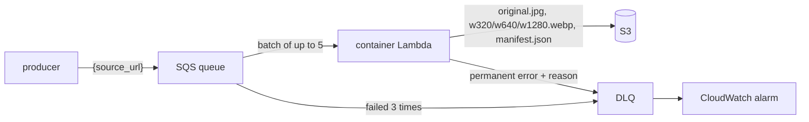

**English** | [Português](README.pt-BR.md)

# pulumi-sqs-lambda-worker

A serverless worker on AWS, defined with Pulumi in Python: an SQS queue feeds a container-image
Lambda function, which writes its results to S3. The infrastructure is a reusable component. The
example job downloads images and writes WebP thumbnails.

[](https://github.com/ErickBonruque/pulumi-sqs-lambda-worker/actions/workflows/ci.yml)
[](LICENSE)


## Result

27 public-domain / CC0 images from Wikimedia Commons, in 5 formats
([list with author and licence](examples/commons_sample.csv)), processed by the same code that runs
in Lambda:

| Source format | Images | Median source | Median w640.webp | w640 / source | Median render (local) |
|---|---:|---:|---:|---:|---:|
| GIF | 6 | 4.72 MB | 40 KB | 1.3% | 0.27 s |
| JPEG | 6 | 0.48 MB | 46 KB | 6.6% | 0.29 s |
| PNG | 6 | 1.13 MB | 12 KB | 2.0% | 0.25 s |
| TIFF | 6 | 15.12 MB | 77 KB | 0.6% | 0.44 s |
| WEBP | 3 | 0.03 MB | 27 KB | 85.7% | 0.09 s |
| **all** | 27 | 1.25 MB | 36 KB | 1.6% | 0.32 s |

In total, 115.0 MB of source files become 1.10 MB of w640 thumbnails. Render time was measured on a
laptop (Intel i5-12450H) and does not include the download. Per-image data is in
[`results/commons_run.csv`](results/commons_run.csv).

On the first run, 2 downloads failed with a temporary error. The second run processed only those 2:
it skipped the other 25 because their `manifest.json` already existed.


*`w640.webp` (15 KB) of a 1920×1280 NASA photo, public domain.*

## Why

"One message = one unit of work" is a common pattern on AWS. The details that make it work in
production are easy to get wrong: visibility timeout, dead-letter queue, partial batch failures,
concurrency, least-privilege IAM. This repo puts those details in one tested Pulumi component.

## Run it

Without an AWS account, only the job (downloads from Commons, writes to a folder):

```bash
uv sync
uv run thumbnailer --out out/ --urls-file examples/commons_sample.csv
uv run python scripts/summarise_outputs.py out/
```

The Lambda image on your machine (Lambda Runtime Interface Emulator + [moto](https://github.com/getmoto/moto)
in place of S3 and SQS):

```bash
docker compose up -d --build --wait
uv run python scripts/local_demo.py --limit 5
docker compose down
```

On AWS (needs credentials and a Pulumi backend):

```bash
pulumi stack init dev && pulumi config set aws:region us-east-1
pulumi up
aws sqs send-message --queue-url "$(pulumi stack output queue_url)" \
  --message-body '{"source_url": "https://upload.wikimedia.org/wikipedia/commons/8/80/Artemis_II_art002e021278_earthset.jpg"}'
```

## How it works



**Infrastructure** (`src/sqs_lambda_worker/`, program in `infra/__main__.py`): 17 AWS resources and the image build.

- Queue visibility timeout = 6 × function timeout + batching window (the AWS guidance). This stops
  a second delivery of a message while a slow invocation still runs.
- `ReportBatchItemFailures`: the function returns only the IDs that failed. SQS deletes the rest of
  the batch.
- `maximum_concurrency` on the event source mapping, not reserved concurrency on the function. With
  reserved concurrency, SQS keeps delivering, Lambda throttles, and good messages use up their
  attempts and land in the DLQ.
- DLQ with 14-day retention (the maximum), a `RedriveAllowPolicy` that accepts only our queue, and
  an alarm when the DLQ is not empty.
- One inline IAM policy per need, each on a single ARN: consume the queue, send to the DLQ, write to
  its own log group, read and write one S3 prefix. No `"Resource": "*"`. The `s3:ListBucket`
  permission (limited to the prefix) is there on purpose: without it, `HeadObject` on a missing key
  returns 403, not 404.
- Pulumi builds the image and pushes it to ECR (`pulumi-docker-build`); the function uses it by
  digest. JSON logs with retention. Governance tags on every resource.

**Job** (`src/thumbnailer/`):

1. Validate the message. The `image_id` is a hash of the URL, so the same URL always goes to the
   same folder.
2. If `manifest.json` already exists, skip (idempotent: SQS delivers "at least once").
3. Download the URL. It is untrusted input: `https` only, allowed hosts only (also for redirects),
   TLS verified, byte limit checked while reading.
4. Reject images that are too large before decoding them ("decompression bomb" protection), apply
   the EXIF rotation, convert any colour mode to RGB (transparent pixels become white).
5. Write the normalised JPEG and the WebP thumbnails. The manifest is written last.

Each error is **permanent** (invalid message, host not allowed, HTTP 404, not an image: it goes
straight to the DLQ with the reason) or **temporary** (timeout, HTTP 5xx/429: it goes back to the
queue and SQS tries again).

## Tests

93 tests, no AWS account needed: `uv run pytest`.

- Job: formats and colour modes, EXIF, download and pixel limits, redirect to a host that is not
  allowed, handler with S3 and SQS emulated by moto (success, retry, DLQ, mixed batch).
- Infrastructure: the component runs on the Pulumi mock engine. The tests check timeouts, redrive,
  IAM policies without wildcards and tags on every resource.

CI also builds the image and invokes the function through the emulator, and runs `pulumi preview`
with a local backend and fake credentials ([`scripts/preview_offline.sh`](scripts/preview_offline.sh)).

## Stack

Python 3.11+, Pulumi (`pulumi-aws` 7, `pulumi-docker-build`), Pillow, boto3, Docker, uv,
pytest + moto, ruff, mypy (strict), GitHub Actions.

## Limitations

- CI does not deploy to a real AWS account. `pulumi preview` checks the program and the resource
  types, but not the permissions in the cloud.
- A host outside the allow-list is rejected. There is no extra check for an allowed host that
  resolves to an internal IP address (the allow-list is the defence).
- The times in the table are local. On Lambda they depend on the memory setting (CPU scales with
  memory).

## License

[MIT](LICENSE). The example images are not in the repo: the list links to Commons, with the author
and licence of each file. The only exception is the thumbnail in `docs/`, made from a public-domain
NASA photo.
