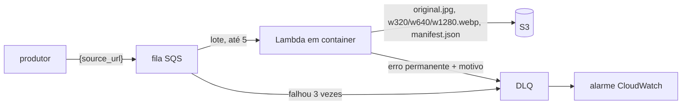

[English](README.md) | **Português**

# pulumi-sqs-lambda-worker

Worker serverless na AWS definido em Pulumi (Python): uma fila SQS alimenta uma função Lambda em
container, que grava o resultado no S3. A infraestrutura é um componente reutilizável; o job de
exemplo baixa imagens e gera miniaturas WebP.

[](https://github.com/ErickBonruque/pulumi-sqs-lambda-worker/actions/workflows/ci.yml)
[](LICENSE)


## Resultado

27 imagens de domínio público / CC0 do Wikimedia Commons, em 5 formatos
([lista com autor e licença](examples/commons_sample.csv)), processadas pelo mesmo código que roda
na Lambda:

| Formato de origem | Imagens | Mediana da origem | Mediana do w640.webp | w640 / origem | Mediana de render (local) |
|---|---:|---:|---:|---:|---:|
| GIF | 6 | 4.72 MB | 40 KB | 1.3% | 0.27 s |
| JPEG | 6 | 0.48 MB | 46 KB | 6.6% | 0.29 s |
| PNG | 6 | 1.13 MB | 12 KB | 2.0% | 0.25 s |
| TIFF | 6 | 15.12 MB | 77 KB | 0.6% | 0.44 s |
| WEBP | 3 | 0.03 MB | 27 KB | 85.7% | 0.09 s |
| **todas** | 27 | 1.25 MB | 36 KB | 1.6% | 0.32 s |

Total: 115,0 MB de originais viram 1,10 MB de miniaturas w640. Render medido num notebook (Intel
i5-12450H), sem contar download. Dados por imagem em [`results/commons_run.csv`](results/commons_run.csv).

Na primeira execução, 2 downloads falharam com erro temporário. A segunda execução processou só
essas 2: as outras 25 foram puladas porque o `manifest.json` delas já existia.


*`w640.webp` (15 KB) de uma foto de 1920×1280 da NASA, domínio público.*

## Por que existe

"Uma mensagem = uma unidade de trabalho" é um padrão comum na AWS, e os detalhes que fazem ele
funcionar em produção são fáceis de errar: visibility timeout, DLQ, falha parcial de lote,
concorrência, IAM mínimo. Este repo junta esses detalhes num componente Pulumi testado.

## Como rodar

Sem conta AWS, só o job (baixa do Commons e grava numa pasta):

```bash
uv sync
uv run thumbnailer --out out/ --urls-file examples/commons_sample.csv
uv run python scripts/summarise_outputs.py out/
```

A imagem da Lambda localmente (emulador do Lambda + [moto](https://github.com/getmoto/moto) no lugar
de S3 e SQS):

```bash
docker compose up -d --build --wait
uv run python scripts/local_demo.py --limit 5
docker compose down
```

Na AWS (precisa de credenciais e de um backend do Pulumi):

```bash
pulumi stack init dev && pulumi config set aws:region us-east-1
pulumi up
aws sqs send-message --queue-url "$(pulumi stack output queue_url)" \
  --message-body '{"source_url": "https://upload.wikimedia.org/wikipedia/commons/8/80/Artemis_II_art002e021278_earthset.jpg"}'
```

## Como funciona



**Infraestrutura** (`src/sqs_lambda_worker/`, programa em `infra/__main__.py`): 17 recursos AWS e o build da imagem.

- Visibility timeout da fila = 6 × timeout da função + janela de lote (recomendação da AWS), para a
  mesma mensagem não ser entregue duas vezes enquanto uma invocação lenta ainda roda.
- `ReportBatchItemFailures`: a função devolve só os IDs que falharam; o resto do lote é apagado.
- `maximum_concurrency` no event source mapping, e não concorrência reservada na função. Com
  concorrência reservada, o SQS continua entregando, a Lambda recusa, e mensagens boas gastam
  tentativas e caem na DLQ.
- DLQ com retenção de 14 dias (o máximo), `RedriveAllowPolicy` que só aceita a nossa fila, alarme
  quando a DLQ não está vazia.
- Uma política IAM inline por necessidade, cada uma num único ARN: consumir a fila, enviar à DLQ,
  escrever no próprio log group, ler e escrever num prefixo do S3. Nada de `"Resource": "*"`.
  O `s3:ListBucket` limitado ao prefixo está lá de propósito: sem ele, `HeadObject` numa chave que
  não existe devolve 403 em vez de 404.
- Imagem construída e enviada ao ECR pelo próprio Pulumi (`pulumi-docker-build`), referenciada por
  digest; logs em JSON com retenção; tags de governança em todo recurso.

**Job** (`src/thumbnailer/`):

1. Valida a mensagem. O `image_id` é um hash da URL, então a mesma URL vai sempre para a mesma pasta.
2. Se `manifest.json` já existe, pula (idempotente: o SQS entrega "pelo menos uma vez").
3. Baixa a URL, que é entrada não confiável: só `https`, só hosts permitidos (também nos
   redirecionamentos), TLS verificado, limite de bytes durante a leitura.
4. Recusa imagens grandes demais antes de decodificar (proteção contra "decompression bomb"),
   aplica a rotação EXIF, converte qualquer modo de cor para RGB (transparência vira branco).
5. Grava o JPEG normalizado e as miniaturas WebP; o manifesto vai por último.

Cada erro é **permanente** (mensagem inválida, host proibido, HTTP 404, não é imagem: vai direto para
a DLQ com o motivo) ou **temporário** (timeout, HTTP 5xx/429: volta para a fila e o SQS tenta de novo).

## Testes

93 testes, sem conta AWS: `uv run pytest`.

- Job: formatos e modos de cor, EXIF, limites de download e de pixels, redirecionamento para host
  proibido, handler com S3 e SQS simulados pelo moto (sucesso, retry, DLQ, lote misto).
- Infra: o componente roda no motor de mocks do Pulumi; os testes conferem timeouts, redrive,
  políticas IAM sem curinga e tags em todo recurso.

O CI também constrói a imagem e invoca a função pelo emulador, e roda `pulumi preview` com backend
local e credenciais falsas ([`scripts/preview_offline.sh`](scripts/preview_offline.sh)).

## Stack

Python 3.11+, Pulumi (`pulumi-aws` 7, `pulumi-docker-build`), Pillow, boto3, Docker, uv,
pytest + moto, ruff, mypy (strict), GitHub Actions.

## Limitações

- O CI não faz deploy numa conta AWS de verdade. O `pulumi preview` valida o programa e os tipos dos
  recursos, mas não as permissões na nuvem.
- Um host fora da lista é recusado; não há proteção extra contra um host permitido que resolve para
  IP interno (a lista de hosts é a defesa).
- Os tempos da tabela são locais. Na Lambda dependem da memória configurada (a CPU acompanha a memória).

## Licença

[MIT](LICENSE). As imagens de exemplo não fazem parte do repo: a lista aponta para o Commons, com
autor e licença de cada arquivo. A única exceção é a miniatura em `docs/`, feita de uma foto da NASA
em domínio público.
